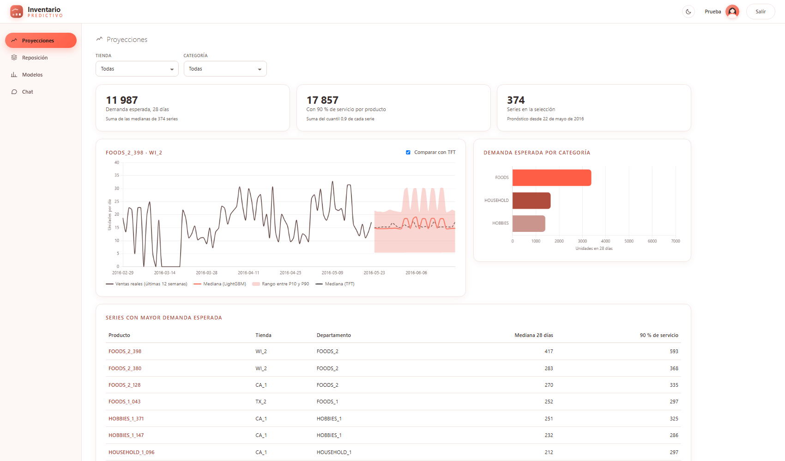
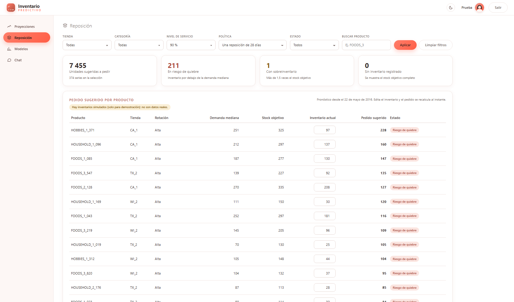
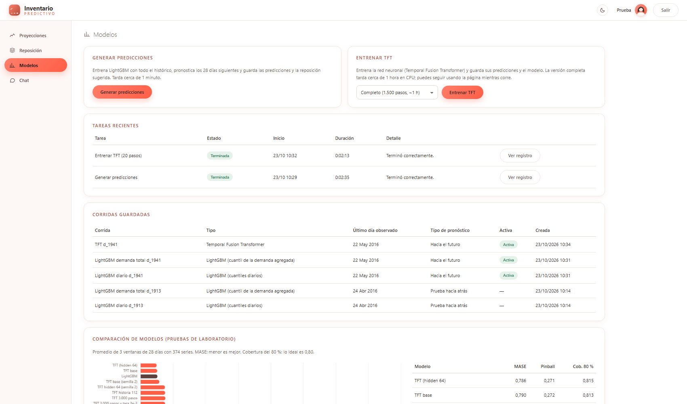
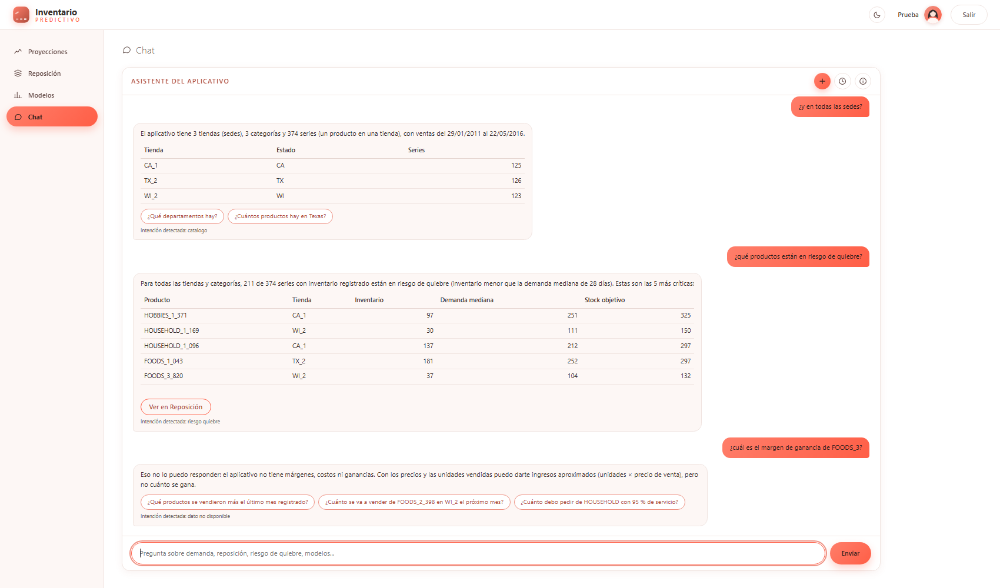

# Producto: Inventario predictivo (Django + PostgreSQL)

Aplicación web que muestra el pronóstico probabilístico de demanda (P10, P50, P90) de los próximos 28 días, sugiere cuánto reponer según el nivel de servicio y responde preguntas en un chat acotado al aplicativo.
Usa los modelos del [laboratorio](../laboratorio/README.md) (ver «Cómo se integran» en el [README general](../README.md)).

Los datos de M5 (Walmart) **no se pueden redistribuir** (reglas de Kaggle): este repositorio solo contiene código; los datos se cargan desde tu computador a tu base local.

| Proyecciones | Reposición |
|---|---|
|  |  |
| **Modelos** | **Chat** |
|  |  |

## Arquitectura
- **Django (MTV)**, 4 apps en `apps/`: `catalogo` (tiendas, series, ventas, calendario, precios), `pronosticos` (corridas de modelos, predicciones, sugerencias de reposición, métricas, tareas), `panel` (páginas del panel y perfil) y `chat` (sesiones, historial y procesamiento de lenguaje).
- **PostgreSQL** como base de datos. `ml/` contiene el código de los modelos que lee de la base (LightGBM diario, LightGBM de la demanda total y TFT).
- Los modelos no se ejecutan dentro de la petición web: cada tarea larga corre en un proceso aparte (`manage.py ejecutar_tarea`), escribe su registro y la web solo lee la base.
- Acceso simple con usuario y contraseña; todo el sitio lo exige. Temas claro y oscuro.

## Puesta en marcha (Windows, PowerShell)

### 0. Datos
Necesitas la tabla maestra de las 374 series y los CSV de M5. Sigue primero los pasos de datos del [laboratorio](../laboratorio/README.md) (paso 1: construir `datos_completa`).

### 1. Base de datos
En pgAdmin (o `psql`), sobre la base `postgres`, cambiando la contraseña:
```sql
CREATE USER inventario_app WITH PASSWORD 'cambia-esta-contrasena';
CREATE DATABASE inventario OWNER inventario_app ENCODING 'UTF8';
```

### 2. Variables de entorno
Copia `.env.example` como `.env` (no se sube a git) y rellénalo: conexión a PostgreSQL, `DJANGO_SECRET_KEY` y, si tus carpetas no están junto al repositorio, las rutas de los datos (`M5_DIR`, `TABLA_MAESTRA`, `SERIES_CSV`, `RESULTADOS_LAB`, `MODELOS_DIR`, `LOGS_DIR`).
Por defecto se busca `laboratorio/` y `m5-forecasting-accuracy/` junto a esta carpeta.

### 3. Entorno de Python (3.10 a 3.12)
```powershell
python -m venv .venv
.venv\Scripts\pip install -r requirements.txt
```

### 4. Tablas, usuario y datos
```powershell
.venv\Scripts\python manage.py migrate
.venv\Scripts\python manage.py createsuperuser      # el acceso simple de la demostración
.venv\Scripts\python manage.py cargar_datos         # calendario, series, ventas y precios (unos minutos)
.venv\Scripts\python manage.py cargar_metricas      # métricas del laboratorio, para la pestaña Modelos
.venv\Scripts\python manage.py runserver
```
Abre http://127.0.0.1:8000/ e inicia sesión. En **Mi perfil** (tu nombre arriba a la derecha) eliges el avatar y cambias la contraseña.

### 5. Predicciones desde la interfaz
En la pestaña **Modelos**:
- **Generar predicciones:** entrena LightGBM con todo el histórico, pronostica los 28 días siguientes y guarda predicciones y reposición sugerida (~1 min).
- **Entrenar TFT:** entrena la red neuronal (1.500 pasos, ~1 h en CPU; hay una prueba rápida de 20 pasos) y guarda sus predicciones y el modelo.

Equivalen a `python manage.py generar_predicciones` y `python manage.py entrenar_tft [--pasos N]`.

La pestaña **Reposición** calcula `pedido = stock objetivo − inventario actual` al editar el inventario. M5 no trae inventarios; para una demostración puedes generar inventarios **simulados** (quedan marcados como tales):
```powershell
.venv\Scripts\python manage.py sembrar_inventario_demo
```

## Pruebas
```powershell
.venv\Scripts\python manage.py test --settings=config.settings_test
```
Usan SQLite en memoria (no necesitan PostgreSQL ni los datos de M5; crean una base mínima propia). Cubren: extracción de entidades y reglas del chat, respuestas con datos, alcance («fuera de contexto», datos que no existen, periodos sin datos), sesiones e historial, memoria de la conversación,
acceso obligatorio en todo el sitio, inicio y cierre de sesión, perfil, cambio de contraseña y filtros de reposición. Hay 45 pruebas.

## Chat
Pestaña **Chat**: preguntas en español sobre las ventas registradas (pasado) y las proyecciones (futuro), la reposición, el riesgo de quiebre, el inventario, los modelos y el significado de los términos
(por ejemplo «¿Cuánto debo pedir de HOUSEHOLD con 95 % de servicio?» o «¿y en Texas?»). Lo que está fuera del aplicativo se rechaza con el mensaje
«Disculpa, pero ese tema se sale del contexto del aplicativo, solo estoy autorizado para responder en contexto del aplicativo.»

Cómo funciona (sin APIs de modelos de lenguaje):
1. **Entidades** (tienda, categoría, departamento, producto, nivel de servicio, periodo, modelo, cantidad) con reglas; se validan contra la base.
2. **Reglas de análisis** (`apps/chat/nlp/analisis.py` y `analisis_extra.py`) para preguntas cotidianas con datos (fin de semana, días SNAP, eventos, precios, ingresos aproximados, participación, crecimiento, cobertura de inventario...) y respuestas honestas cuando el dato no existe (costos, proveedores, clientes...).
3. **Intención** con un clasificador pequeño (regresión logística sobre TF-IDF, pistas léxicas y la intención anterior), entrenado en segundos con frases generadas con plantillas y frases escritas por agentes de IA.
4. **Memoria de la conversación**: lo mencionado (tienda, categoría, producto, periodo) se recuerda en la sesión, incluidas referencias como «el segundo de la lista». El botón «Olvidar contexto» la borra.
5. **Respuesta**: consultas ya escritas sobre PostgreSQL con frases plantilla; el texto del usuario nunca se convierte en SQL, así que no inventa datos. Si no está seguro, pide confirmar entre dos opciones.
6. **Historial**: cada conversación y mensaje (con intención y confianza) se guardan en la base (`SesionChat` y `MensajeChat`).

```powershell
.venv\Scripts\python manage.py entrenar_chat    # entrena y evalúa el clasificador (se entrena solo en el primer uso si no existe)
```

Evaluación (agentes de IA que simulan usuarios, no personas reales; ver `apps/chat/nlp/evaluacion_agentes.json`): 19 agentes escribieron 1.646 frases etiquetadas en tres rondas. Antes de entrenar con ellas, el chat acertó 88,0 % (ronda 1, 734 frases), 84,1 % (ronda 2, más difícil, 517) y 91,6 % (ronda 3, 394) en sentido funcional (83 % a 89 % exigiendo la intención exacta).
En una cuarta ronda, 329 preguntas cotidianas (incluidas 14 conversaciones de 5 a 6 turnos): tras los arreglos, 8 quedan sin resolver.
Limitaciones: entiende bien las formas habituales de preguntar sobre estos temas, pero no es una conversación libre; con redacciones muy distintas puede pedir confirmación o responder fuera de contexto. No se juzgó una por una la corrección de cada cifra.

## Seguridad y datos
`.env` nunca se sube. La clave secreta por defecto es solo para desarrollo: cámbiala. Los inventarios de la demostración son simulados y están marcados como tales.
